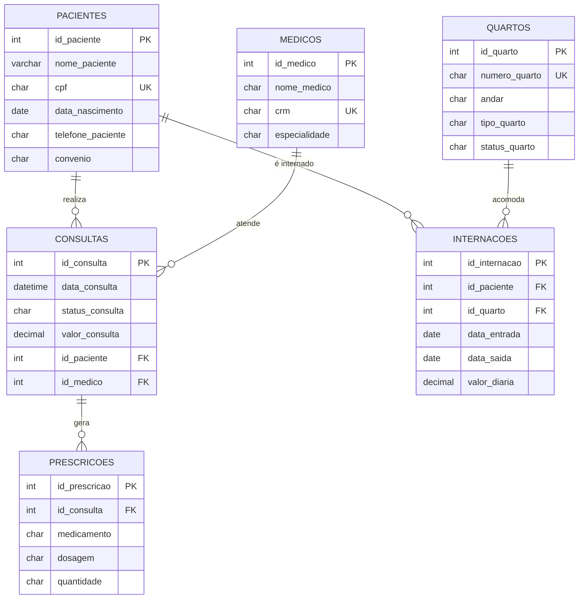

# 🏥 hospital_db — Banco de Dados Hospitalar com 10 Consultas SQL

Projeto de banco de dados relacional em **MySQL** que simula o dia a dia de um hospital: pacientes, médicos, consultas, internações, quartos e prescrições de medicamentos.

Sobre essa base foram criadas **10 consultas SQL** que respondem a situações-problema reais de diferentes setores do hospital (financeiro, coordenação clínica, farmácia, auditoria, cobrança, etc.), usando funções de agregação (`SUM`, `AVG`, `COUNT`), filtros (`WHERE`, `LIKE`, `IN`), agrupamentos (`GROUP BY`) e junções (`JOIN`).

---

## 📑 Sumário

1. [Tecnologias e conceitos](#-tecnologias-e-conceitos)
2. [Como executar](#-como-executar)
3. [Estrutura do banco de dados](#-estrutura-do-banco-de-dados)
4. [Como o script de criação funciona](#-como-o-script-de-criação-funciona)
5. [Dados de exemplo](#-dados-de-exemplo)
6. [As 10 consultas (com prints da execução)](#-as-10-consultas)
7. [Resumo das consultas](#-resumo-das-consultas)
8. [Observações importantes](#-observações-importantes)

---

## 🛠 Tecnologias e conceitos

| Item | Descrição |
|---|---|
| **SGBD** | MySQL (testado no MySQL Workbench) |
| **Engine** | InnoDB (suporta chaves estrangeiras) |
| **Funções de agregação** | `SUM`, `AVG`, `COUNT`, `ROUND` |
| **Filtros** | `WHERE`, `LIKE`, `IN`, `OR`, `=` |
| **Agrupamento e ordenação** | `GROUP BY`, `ORDER BY` |
| **Junções** | `JOIN` / `INNER JOIN` entre até 3 tabelas |

---

## ▶ Como executar

1. Abra o **MySQL Workbench** (ou outro cliente MySQL).
2. Execute **primeiro** o script de criação do banco e das tabelas.
3. Execute **depois** o script de inserção de dados.
4. Por fim, rode as consultas, uma de cada vez (selecione a consulta e use `Ctrl + Enter`).

> O script de criação começa com `DROP TABLE IF EXISTS`, então ele pode ser executado quantas vezes você quiser. Ele sempre recria tudo do zero.

### 📁 Estrutura do repositório

```
📦 projeto
 ┣ 📄 README.md              ← este arquivo
 ┗ 📂 imagens
    ┣ 🖼 consulta_01.png     ← print da execução da consulta 1
    ┣ 🖼 consulta_02.png     ← print da execução da consulta 2
    ┣ 🖼 ...
    ┗ 🖼 consulta_10.png     ← print da execução da consulta 10
```

> As imagens são carregadas pelo README por **caminho relativo** (`imagens/consulta_XX.png`). Para elas aparecerem no GitHub, mantenha a pasta `imagens` no mesmo nível do `README.md`.

---

## 🗂 Estrutura do banco de dados

### Diagrama de relacionamento



### As 6 tabelas

| Tabela | Para que serve | Chaves |
|---|---|---|
| `pacientes` | Cadastro dos pacientes, incluindo o **convênio** de cada um | PK: `id_paciente` |
| `medicos` | Cadastro dos médicos e suas **especialidades** | PK: `id_medico` |
| `quartos` | Quartos do hospital e seu **tipo** (UTI, Apartamento, Enfermaria, Suíte VIP) | PK: `id_quarto` |
| `internacoes` | Liga um paciente a um quarto por um período, com o **valor da diária** | FK: `id_paciente`, `id_quarto` |
| `consultas` | Liga um paciente a um médico em uma data, com **status** e **valor** | FK: `id_paciente`, `id_medico` |
| `prescricoes` | Medicamentos receitados em cada consulta | FK: `id_consulta` |

### Como as tabelas se conectam

- Um **paciente** pode ter várias **consultas** e várias **internações**.
- Um **médico** pode atender várias **consultas**.
- Um **quarto** pode receber várias **internações** ao longo do tempo.
- Uma **consulta** pode gerar várias **prescrições**.

É por essas ligações (as chaves estrangeiras) que os `JOIN` das consultas funcionam. Por exemplo, para saber o convênio de uma consulta, o caminho é `consultas → pacientes`. Para saber a especialidade, é `consultas → medicos`.

---

## ⚙ Como o script de criação funciona

```sql
-- Criacao do Banco de Dados

CREATE DATABASE IF NOT EXISTS hospital_db;

USE hospital_db;

-- Remocao de tabelas pré-existentes para garantir reexecucao limpa
DROP TABLE IF EXISTS prescricoes;
DROP TABLE IF EXISTS consultas;
DROP TABLE IF EXISTS internacoes;
DROP TABLE IF EXISTS quartos;
DROP TABLE IF EXISTS medicos;
DROP TABLE IF EXISTS pacientes;

-- Tabela: Pacientes
create table if not exists pacientes(
    id_paciente int auto_increment primary key,
    nome_paciente varchar(100) not null,
    cpf char(14) not null unique,
    data_nascimento date not null,
    telefone_paciente char(15),
    convenio char(50) not null
) ENGINE=InnoDB;

-- Tabela: Médicos
create table if not exists medicos(
    id_medico int auto_increment primary key,
    nome_medico char(100) not null,
    crm char(12) not null unique,
    especialidade char(50) not null
) ENGINE=InnoDB;

-- Tabela: Quartos
create table if not exists quartos(
    id_quarto int auto_increment primary key,
    numero_quarto char(3) not null unique,
    andar char(3) not null,
    tipo_quarto char(30) not null,
    status_quarto char(20) not null default 'Livre'
) ENGINE=InnoDB;

-- Tabela: Internações (Relacionamento com Pacientes e Quartos)
create table if not exists internacoes(
    id_internacao int auto_increment primary key,
    id_paciente int not null,
    id_quarto int not null,
    data_entrada date not null,
    data_saida date,
    valor_diaria decimal(10,2) not null,
    foreign key (id_quarto)   references quartos(id_quarto),
    foreign key (id_paciente) references pacientes(id_paciente)
) Engine=InnoDB;

-- Tabela: Consultas (Relacionamento com Pacientes e Médicos)
create table if not exists consultas(
    id_consulta int auto_increment primary key,
    data_consulta datetime not null,
    status_consulta char(20),
    valor_consulta decimal(10,2),
    id_paciente int not null,
    id_medico int not null,
    foreign key (id_paciente) references pacientes(id_paciente),
    foreign key (id_medico) references medicos(id_medico)
) Engine=InnoDB;

-- Tabela: Prescrições (Relacionamento com Consultas)
create table if not exists prescricoes(
    id_prescricao int auto_increment primary key,
    id_consulta int not null,
    medicamento char(100) not null,
    dosagem char(50) not null,
    quantidade char(30) not null,
    foreign key (id_consulta) references consultas(id_consulta)
) Engine=InnoDB;

-- Criacao de Índices para otimizacao de buscas frequentes
CREATE INDEX idx_pacientes_nome ON pacientes(nome_paciente);
CREATE INDEX idx_medicos_especialidade ON medicos(especialidade);
CREATE INDEX idx_consultas_data ON consultas(data_consulta);
```

### Explicação passo a passo

**1. Criação e seleção do banco.** `CREATE DATABASE IF NOT EXISTS` cria o banco `hospital_db` só se ele ainda não existir, e `USE hospital_db` seleciona esse banco para os comandos seguintes.

**2. Remoção de tabelas antigas.** Os `DROP TABLE IF EXISTS` apagam as tabelas caso já existam, o que permite rodar o script várias vezes sem erro. A **ordem importa**: as tabelas que dependem de outras (`prescricoes`, `consultas`, `internacoes`) são apagadas **antes** das tabelas que elas referenciam (`quartos`, `medicos`, `pacientes`). Se a ordem fosse inversa, o MySQL bloquearia o `DROP` por causa das chaves estrangeiras.

**3. Criação das tabelas.** As tabelas "base" (`pacientes`, `medicos`, `quartos`) são criadas primeiro, porque não dependem de ninguém. Depois vêm as que têm chave estrangeira (`internacoes`, `consultas`, `prescricoes`), que só podem ser criadas quando a tabela referenciada já existe.

**4. Tipos e restrições usados:**

| Recurso | Onde aparece | O que faz |
|---|---|---|
| `auto_increment primary key` | todos os `id_...` | Gera o identificador automaticamente (1, 2, 3...) e garante que ele seja único |
| `not null` | quase todas as colunas | Obriga o preenchimento do campo |
| `unique` | `cpf`, `crm`, `numero_quarto` | Impede dois registros com o mesmo valor |
| `default 'Livre'` | `status_quarto` | Se nenhum status for informado, o quarto entra como "Livre" |
| `decimal(10,2)` | valores em dinheiro | Guarda números com 2 casas decimais, sem erro de arredondamento |
| `foreign key ... references` | tabelas de relacionamento | Garante que só exista, por exemplo, uma consulta de um paciente que realmente existe |

**5. Índices.** Os três `CREATE INDEX` aceleram buscas em colunas muito consultadas: o nome do paciente, a especialidade do médico e a data da consulta. Com muitos registros, o banco localiza essas informações mais rápido.

---

## 📥 Dados de exemplo

O banco é populado com **10 registros em cada tabela**, para que as consultas tenham o que calcular.

<details>
<summary><b>Clique para ver o script completo de inserção</b></summary>

```sql
USE hospital_db;

-- Insercao em Pacientes
INSERT INTO pacientes (nome_paciente, cpf, data_nascimento, telefone_paciente, convenio) VALUES
('Ana Silva', '111.222.333-01', '1985-03-15', '(11) 98765-4321', 'Unimed'),
('Carlos Oliveira', '222.333.444-02', '1990-07-22', '(11) 97654-3210', 'Bradesco Saúde'),
('Maria Santos', '333.444.555-03', '1978-11-05', '(11) 96543-2109', 'Unimed'),
('João Pedro Silva', '444.555.666-04', '2000-01-30', '(11) 95432-1098', 'Particular'),
('Fernanda Costa', '555.666.777-05', '1995-09-12', '(11) 94321-0987', 'Amil'),
('Roberto Almeida', '666.777.888-06', '1962-04-18', '(11) 93210-9876', 'SulAmérica'),
('Juliana Oliveira', '777.888.999-07', '1988-12-08', '(11) 92109-8765', 'Unimed Pleno'),
('Lucas Souza', '888.999.000-08', '2003-05-25', '(11) 91098-7654', 'Particular'),
('Beatriz Lima', '999.000.111-09', '1973-08-02', '(11) 90987-6543', 'Bradesco Saúde'),
('Ricardo Pereira', '000.111.222-10', '1981-10-19', '(11) 98877-6655', 'Amil');

-- Insercao em Médicos
INSERT INTO medicos (nome_medico, crm, especialidade) VALUES
('Dr. Marcos Andrade', 'CRM/SP 12345', 'Cardiologia'),
('Dra. Patricia Lima', 'CRM/SP 23456', 'Pediatria'),
('Dr. Roberto Silva', 'CRM/SP 34567', 'Cardiologia Pediatrica'),
('Dra. Camila Rocha', 'CRM/SP 45678', 'Cirurgia Geral'),
('Dr. Gustavo Santos', 'CRM/SP 56789', 'Ortopedia'),
('Dra. Vanessa Martins', 'CRM/SP 67890', 'Cirurgia Vascular'),
('Dr. Felipe Barbosa', 'CRM/SP 78901', 'Neurologia'),
('Dra. Renata Mello', 'CRM/SP 89012', 'Ginecologia'),
('Dr. Eduardo Ramos', 'CRM/SP 90123', 'Dermatologia'),
('Dra. Claudia Castro', 'CRM/SP 01234', 'Cirurgia Plastica');

-- Insercao em Quartos
INSERT INTO quartos (numero_quarto, andar, tipo_quarto, status_quarto) VALUES
(101, 1, 'UTI', 'Ocupado'),
(102, 1, 'Enfermaria', 'Livre'),
(201, 2, 'Apartamento', 'Ocupado'),
(202, 2, 'Apartamento', 'Livre'),
(301, 3, 'UTI', 'Ocupado'),
(302, 3, 'Enfermaria', 'Ocupado'),
(401, 4, 'Suíte VIP', 'Livre'),
(402, 4, 'Apartamento', 'Ocupado'),
(501, 5, 'UTI', 'Livre'),
(502, 5, 'Enfermaria', 'Ocupado');

-- Insercao em Internações
INSERT INTO internacoes (id_paciente, id_quarto, data_entrada, data_saida, valor_diaria) VALUES
(1, 1, '2026-02-10', '2026-02-20', 450.00),
(2, 3, '2026-03-01', '2026-03-10', 300.00),
(3, 5, '2026-04-15', '2026-04-25', 500.00),
(7, 6, '2026-05-01', '2026-05-08', 250.00),
(5, 8, '2026-06-10', '2026-06-18', 350.00),
(6, 10, '2026-07-01', '2026-07-10', 280.00),
(2, 1, '2026-08-05', '2026-08-12', 450.00),
(4, 2, '2026-01-15', '2026-01-22', 200.00),
(8, 4, '2026-02-20', '2026-02-28', 320.00),
(9, 7, '2026-03-12', '2026-03-19', 600.00);

-- Insercao em Consultas
INSERT INTO consultas (id_paciente, id_medico, data_consulta, status_consulta, valor_consulta) VALUES
(1, 1, '2026-01-10 09:00:00', 'Realizada', 350.00),
(1, 4, '2026-02-05 14:00:00', 'Realizada', 500.00),
(2, 3, '2026-03-01 10:30:00', 'Realizada', 400.00),
(3, 2, '2026-03-15 11:00:00', 'Realizada', 280.00),
(4, 6, '2026-04-10 15:00:00', 'Realizada', 550.00),
(5, 5, '2026-05-02 08:30:00', 'Realizada', 320.00),
(6, 1, '2026-05-20 16:00:00', 'Realizada', 350.00),
(7, 10, '2026-06-01 13:00:00', 'Realizada', 600.00),
(8, 8, '2026-06-15 10:00:00', 'Realizada', 300.00),
(1, 4, '2026-07-01 14:00:00', 'Realizada', 500.00);

-- Insercao em Prescrições
INSERT INTO prescricoes (id_consulta, medicamento, dosagem, quantidade) VALUES
(1, 'Dipirona 500mg', '1 comprimido de 6h/6h', 20),
(1, 'Amoxicilina 500mg', '1 capsula de 8h/8h', 21),
(2, 'Ibuprofeno 600mg', '1 comprimido de 12h/12h', 10),
(3, 'Paracetamol 750mg', '1 comprimido de 8h/8h', 15),
(4, 'Omeprazol 20mg', '1 capsula em jejum', 30),
(5, 'Cetanest', 'Aplicar via IV', 5),
(6, 'Dorflex', '1 comprimido se dor', 12),
(7, 'Atenolol 50mg', '1 comprimido ao dia', 30),
(8, 'Cefalexina 500mg', '1 capsula de 6h/6h', 28),
(10, 'Tramadol 50mg', '1 comprimido de 8h/8h', 10);
```

</details>

### Como a inserção funciona

- Os `id_...` **não são informados** nos `INSERT`, porque o `auto_increment` os gera sozinho (1 a 10 em cada tabela).
- Por isso, os números usados nas tabelas de relacionamento são os ids gerados. Por exemplo, em `consultas`, o registro `(1, 1, ...)` significa "paciente 1 (Ana Silva) com o médico 1 (Dr. Marcos Andrade)".
- A **ordem dos `INSERT`** respeita as dependências: primeiro `pacientes`, `medicos` e `quartos`, depois `internacoes`, `consultas` e `prescricoes`. Se uma consulta fosse inserida antes do paciente existir, a chave estrangeira daria erro.

---

## 🔎 As 10 consultas

Todas começam com `USE hospital_db;` para garantir que o banco correto está selecionado.

```sql
USE hospital_db;
```

### 📸 Como ler os prints da execução

Cada consulta abaixo tem um **print real da execução no MySQL Workbench**. Eles servem como **prova de que a consulta roda e retorna o resultado esperado**, e não apenas como ilustração. Todos os prints seguem o mesmo padrão de tela:

| Parte da tela | O que é |
|---|---|
| **Barra de ferramentas** (topo) | O raio ⚡ executa a consulta. O campo **Limit to 1000 rows** limita a exibição a 1000 linhas, o que não afeta nossos resultados, que têm poucas linhas |
| **Editor de SQL** (parte de cima) | Onde o código fica escrito. A linha 1 é sempre `USE hospital_db;`, seguida do comentário com o número e o título da consulta. As bolinhas azuis ao lado dos números indicam os comandos executáveis |
| **Result Grid** (parte de baixo) | A tabela de resultado devolvida pelo MySQL. Os nomes das colunas vêm dos apelidos criados com `AS` (por exemplo, `faturamento_total`) |

**Como cada print foi feito (o mesmo processo para os 10):**

1. Abrir uma aba de SQL no Workbench (cada consulta ficou na sua própria aba, `SQL File 1`, `SQL File 2` e assim por diante).
2. Escrever o `USE hospital_db;` e a consulta, como aparece no código deste README.
3. Executar com o raio ⚡ (ou `Ctrl + Enter`), com o banco já criado e populado pelos scripts.
4. Com o resultado na tela, tirar a captura mostrando **o código e o Result Grid juntos**, para que quem lê veja a causa (a consulta) e o efeito (o resultado).

---

### 1️⃣ Faturamento total de consultas por convênio

**Situação-problema:** o setor financeiro precisa saber o valor total arrecadado em consultas para os convênios que têm **"Saúde"** no nome, para acompanhar o faturamento por parceiro.

```sql
-- 1. Faturamento total de consultas por convênio ("Saúde" no nome)
SELECT p.convenio,
       SUM(c.valor_consulta) AS faturamento_total
FROM consultas c
JOIN pacientes p ON p.id_paciente = c.id_paciente
WHERE p.convenio LIKE '%Saúde%'
GROUP BY p.convenio;
```

**Como funciona:**

1. O convênio fica na tabela `pacientes`, e o valor fica em `consultas`. Por isso o `JOIN` liga cada consulta ao seu paciente pelo `id_paciente`.
2. `WHERE p.convenio LIKE '%Saúde%'` mantém só convênios com "Saúde" em qualquer posição do nome (os `%` significam "qualquer texto antes e depois").
3. `GROUP BY p.convenio` junta as consultas de cada convênio em uma linha só.
4. `SUM(c.valor_consulta)` soma o valor das consultas de cada grupo.

**Resultado:**

| convenio | faturamento_total |
|---|---|
| Bradesco Saúde | 400.00 |

> Só existe um convênio com "Saúde" no nome. Dos dois pacientes dele (Carlos e Beatriz), só o Carlos tem consulta (R$ 400,00).

#### 📸 Execução no MySQL Workbench


- **O que a imagem mostra:** o código da consulta 1 (linhas 1 a 9) e, no Result Grid, **uma única linha**: `Bradesco Saúde | 400.00`.
- **Como foi feita:** a consulta foi escrita na aba do Workbench e executada. O `LIKE '%Saúde%'` filtrou os convênios, o `GROUP BY` agrupou por convênio e o `SUM` somou os valores.
- **Para que serve e como está sendo usada:** confirma que o filtro funcionou: só um convênio tem "Saúde" no nome, então o resultado correto tem 1 linha. Esse print bate com o valor calculado à mão (R$ 400,00 da consulta do Carlos).

---

### 2️⃣ Média do valor de consulta por especialidade médica

**Situação-problema:** a coordenação clínica quer a média do valor das consultas apenas nas especialidades **ligadas à Cardiologia**.

```sql
-- 2. Média do valor de consulta por especialidade (ligadas à Cardiologia)
SELECT m.especialidade,
       ROUND(AVG(c.valor_consulta),2) AS media_valor_consulta
FROM consultas c
JOIN medicos m ON m.id_medico = c.id_medico
WHERE m.especialidade LIKE '%Cardio%'
GROUP BY m.especialidade;
```

**Como funciona:**

1. O `JOIN` com `medicos` traz a especialidade de cada consulta.
2. `LIKE '%Cardio%'` pega tanto "Cardiologia" quanto "Cardiologia Pediatrica", ou seja, todas as especialidades ligadas à Cardiologia.
3. `GROUP BY m.especialidade` gera uma linha por especialidade.
4. `AVG` calcula a média e `ROUND(..., 2)` limita o resultado a 2 casas decimais.

**Resultado:**

| especialidade | media_valor_consulta |
|---|---|
| Cardiologia | 350.00 |
| Cardiologia Pediatrica | 400.00 |

> Cardiologia: duas consultas de R$ 350,00. Cardiologia Pediatrica: uma consulta de R$ 400,00.

#### 📸 Execução no MySQL Workbench


- **O que a imagem mostra:** o código da consulta 2 e duas linhas no Result Grid: `Cardiologia | 350.00` e `Cardiologia Pediatrica | 400.00`.
- **Como foi feita:** a consulta foi executada com o `ROUND(AVG(...), 2)` já aplicado. Antes do `ROUND`, as médias apareciam com 6 casas decimais (350.000000).
- **Para que serve e como está sendo usada:** mostra que o `LIKE '%Cardio%'` pegou as **duas** especialidades ligadas à Cardiologia e que o `GROUP BY` separou cada uma em sua linha. Também serve de exemplo do efeito do `ROUND`, que deixa o valor pronto para relatório.

---

### 3️⃣ Valor médio das diárias por tipo de quarto

**Situação-problema:** a gerência de infraestrutura quer o valor médio da diária nas internações em acomodações do tipo **"Apartamento"** ou **"UTI"**.

```sql
-- 3. Valor médio das diárias por tipo de quarto ("Apartamento" ou "UTI")
SELECT q.tipo_quarto,
       ROUND(AVG(i.valor_diaria), 2) AS media_diaria
FROM internacoes i
INNER JOIN quartos q ON q.id_quarto = i.id_quarto
WHERE q.tipo_quarto LIKE '%Apartamento%'
OR q.tipo_quarto LIKE '%UTI%'
GROUP BY q.tipo_quarto;
```

**Como funciona:**

1. O `INNER JOIN` liga cada internação ao seu quarto, trazendo o tipo do quarto.
2. O `WHERE` com `OR` mantém só internações em quartos "Apartamento" ou "UTI". Quartos "Enfermaria" e "Suíte VIP" ficam de fora.
3. `GROUP BY q.tipo_quarto` agrupa por tipo.
4. `AVG` calcula a média das diárias de cada tipo.

**Resultado:**

| tipo_quarto | media_diaria |
|---|---|
| Apartamento | 323.33 |
| UTI | 466.67 |

> Apartamento: (300 + 350 + 320) ÷ 3. UTI: (450 + 500 + 450) ÷ 3.

#### 📸 Execução no MySQL Workbench


- **O que a imagem mostra:** o código da consulta 3, com o `INNER JOIN` e o `WHERE ... OR` em linhas separadas, e duas linhas no Result Grid: `UTI | 466.67` e `Apartamento | 323.33`.
- **Como foi feita:** a consulta foi executada normalmente. Repare que a UTI aparece **antes** do Apartamento: como a consulta não tem `ORDER BY`, o MySQL decide a ordem das linhas.
- **Para que serve e como está sendo usada:** valida o filtro com `LIKE` + `OR` (só Apartamento e UTI aparecem; Enfermaria e Suíte VIP ficaram de fora) e mostra os valores arredondados. Os números batem com os cálculos manuais (970 ÷ 3 e 1400 ÷ 3).

---

### 4️⃣ Total de consultas realizadas por médico

**Situação-problema:** a diretoria de atendimento quer um relatório com o nome dos médicos e a **soma dos valores** de suas consultas, considerando só as de status **"Realizada"** ou **"Finalizada"**.

```sql
-- 4. Total de consultas por médico (status "Realizada" ou "Finalizada")
SELECT m.nome_medico,
       SUM(c.valor_consulta) AS total_consultas
FROM consultas c
JOIN medicos m ON m.id_medico = c.id_medico
WHERE c.status_consulta IN ('Realizada', 'Finalizada')
GROUP BY m.nome_medico
ORDER BY total_consultas DESC;
```

**Como funciona:**

1. O `JOIN` com `medicos` traz o nome do médico de cada consulta.
2. `IN ('Realizada', 'Finalizada')` é uma forma curta de escrever `status = 'Realizada' OR status = 'Finalizada'`.
3. `GROUP BY m.nome_medico` gera uma linha por médico.
4. `SUM` soma os valores e `ORDER BY ... DESC` mostra primeiro quem mais faturou.

**Resultado:**

| nome_medico | total_consultas |
|---|---|
| Dra. Camila Rocha | 1000.00 |
| Dr. Marcos Andrade | 700.00 |
| Dra. Claudia Castro | 600.00 |
| Dra. Vanessa Martins | 550.00 |
| Dr. Roberto Silva | 400.00 |
| Dr. Gustavo Santos | 320.00 |
| Dra. Renata Mello | 300.00 |
| Dra. Patricia Lima | 280.00 |

> Dr. Felipe Barbosa e Dr. Eduardo Ramos não aparecem porque não têm consultas. Nos dados atuais não há consulta "Finalizada", mas o filtro está pronto para quando houver.

#### 📸 Execução no MySQL Workbench


- **O que a imagem mostra:** o código da consulta 4 e **8 linhas** no Result Grid, ordenadas do maior para o menor total, de `Dra. Camila Rocha | 1000.00` até `Dra. Patricia Lima | 280.00`.
- **Como foi feita:** a consulta foi executada com o `IN ('Realizada', 'Finalizada')` e o `ORDER BY total_consultas DESC`, que gerou a ordem decrescente visível no print.
- **Para que serve e como está sendo usada:** serve como o relatório da diretoria: quem mais faturou aparece no topo. O print também confirma que os médicos sem consultas (Dr. Felipe Barbosa e Dr. Eduardo Ramos) não aparecem, porque o `JOIN` só traz quem tem consulta.

---

### 5️⃣ Soma de diárias por paciente com sobrenome "Silva"

**Situação-problema:** o setor de cobrança precisa da soma acumulada das diárias de internação de todos os pacientes com sobrenome **"Silva"**.

```sql
-- 5. Soma de diárias por paciente com sobrenome "Silva"
SELECT p.nome_paciente,
       SUM(i.valor_diaria) AS total_diarias
FROM internacoes i
JOIN pacientes p ON p.id_paciente = i.id_paciente
WHERE p.nome_paciente LIKE '% Silva'
GROUP BY p.nome_paciente;
```

**Como funciona:**

1. O `JOIN` liga cada internação ao paciente.
2. `LIKE '% Silva'` (com `%` só no começo) pega nomes que **terminam** em " Silva", ou seja, quem tem "Silva" como último sobrenome. O espaço antes de "Silva" evita pegar nomes como "Silvana".
3. `GROUP BY` e `SUM` somam as diárias de cada paciente.

**Resultado:**

| nome_paciente | total_diarias |
|---|---|
| Ana Silva | 450.00 |
| João Pedro Silva | 200.00 |

> O "Dr. Roberto Silva" também tem esse sobrenome, mas é médico (tabela `medicos`), então não entra nesta consulta.

#### 📸 Execução no MySQL Workbench


- **O que a imagem mostra:** o código da consulta 5 e duas linhas no Result Grid: `Ana Silva | 450.00` e `João Pedro Silva | 200.00`.
- **Como foi feita:** a consulta foi executada com `LIKE '% Silva'` (o `%` só no começo, para pegar nomes que **terminam** em ' Silva').
- **Para que serve e como está sendo usada:** demonstra o uso do `LIKE` para filtrar por sobrenome. O resultado mostra só pacientes (o médico Dr. Roberto Silva não aparece porque está na tabela `medicos`) e o total de diárias de cada um, que é o dado que o setor de cobrança precisa.

---

### 6️⃣ Contagem de prescrições por status da consulta

**Situação-problema:** a farmácia hospitalar quer a quantidade de medicamentos prescritos, agrupada pelo **status da consulta**, considerando só medicamentos que contenham **"Dipirona"** ou **"Paracetamol"**.

```sql
-- 6. Contagem de prescrições por status da consulta (Dipirona ou Paracetamol)
SELECT c.status_consulta,
       COUNT(*) AS qtd_prescricoes
FROM prescricoes pr
JOIN consultas c ON c.id_consulta = pr.id_consulta
WHERE pr.medicamento LIKE '%Dipirona%'
   OR pr.medicamento LIKE '%Paracetamol%'
GROUP BY c.status_consulta;
```

**Como funciona:**

1. O `JOIN` liga cada prescrição à sua consulta, para descobrir o status.
2. O `WHERE` com `OR` mantém só as prescrições de Dipirona ou Paracetamol. Usamos `LIKE` com `%` porque o nome vem com a dosagem junto (por exemplo, "Dipirona 500mg").
3. `GROUP BY c.status_consulta` agrupa por status.
4. `COUNT(*)` conta quantas prescrições há em cada grupo.

**Resultado:**

| status_consulta | qtd_prescricoes |
|---|---|
| Realizada | 2 |

> Uma prescrição de Dipirona 500mg (consulta 1) e uma de Paracetamol 750mg (consulta 3).

#### 📸 Execução no MySQL Workbench


- **O que a imagem mostra:** o código da consulta 6, com o `OR` indentado na linha 9, e **uma linha** no Result Grid: `Realizada | 2`.
- **Como foi feita:** a consulta foi executada ligando `prescricoes` a `consultas` pelo `id_consulta`. O `COUNT(*)` contou as prescrições de Dipirona e Paracetamol dentro de cada status.
- **Para que serve e como está sendo usada:** mostra o resultado que a farmácia pediu. Há apenas uma linha porque todas as consultas de exemplo estão como 'Realizada'; com outros status nos dados, apareceriam mais linhas.

---

### 7️⃣ Média de valor de consultas por convênio e especialidade

**Situação-problema:** em uma negociação contratual, a auditoria quer o valor médio pago por consulta, cruzando os convênios que contêm **"Unimed"** com a **especialidade do médico**.

```sql
-- 7. Média de valor de consultas por convênio ("Unimed") e especialidade
SELECT p.convenio,
       m.especialidade,
       ROUND(AVG(c.valor_consulta),2) AS media_valor_consulta
FROM consultas c
JOIN pacientes p ON p.id_paciente = c.id_paciente
JOIN medicos m ON m.id_medico = c.id_medico
WHERE p.convenio LIKE '%Unimed%'
GROUP BY p.convenio, m.especialidade
ORDER BY p.convenio, m.especialidade;
```

**Como funciona:**

1. Esta consulta usa **dois `JOIN`**: um com `pacientes` (para o convênio) e outro com `medicos` (para a especialidade).
2. `LIKE '%Unimed%'` pega "Unimed" e também "Unimed Pleno".
3. `GROUP BY p.convenio, m.especialidade` agrupa por **combinação** de convênio e especialidade, gerando uma linha para cada par.
4. `AVG` calcula a média de cada par, e o `ORDER BY` organiza o resultado por convênio e especialidade.

**Resultado:**

| convenio | especialidade | media_valor_consulta |
|---|---|---|
| Unimed | Cardiologia | 350.00 |
| Unimed | Cirurgia Geral | 500.00 |
| Unimed | Pediatria | 280.00 |
| Unimed Pleno | Cirurgia Plastica | 600.00 |

#### 📸 Execução no MySQL Workbench


- **O que a imagem mostra:** o código da consulta 7, com **dois `JOIN`**, e **4 linhas** no Result Grid: Unimed/Cardiologia (350.00), Unimed/Cirurgia Geral (500.00), Unimed/Pediatria (280.00) e Unimed Pleno/Cirurgia Plastica (600.00).
- **Como foi feita:** a consulta foi executada cruzando `consultas`, `pacientes` (convênio) e `medicos` (especialidade). O `GROUP BY` usa duas colunas, e o `ORDER BY` deixou o resultado em ordem alfabética.
- **Para que serve e como está sendo usada:** é o print que melhor mostra o agrupamento por **combinação de duas colunas**: cada linha é um par convênio + especialidade. Também comprova que o `LIKE '%Unimed%'` pegou tanto 'Unimed' quanto 'Unimed Pleno'.

---

### 8️⃣ Média de diária de internação por convênio em quartos de UTI

**Situação-problema:** a regulação hospitalar quer o valor médio gasto em diárias, agrupado por **convênio**, considerando só quartos de **UTI**.

```sql
-- 8. Média de diária de internação por convênio em quartos de UTI
SELECT p.convenio,
       ROUND(AVG(i.valor_diaria),2) AS media_diaria_uti
FROM internacoes i
JOIN pacientes p ON p.id_paciente = i.id_paciente
JOIN quartos q ON q.id_quarto = i.id_quarto
WHERE q.tipo_quarto = 'UTI'
GROUP BY p.convenio;
```

**Como funciona:**

1. A internação é ligada ao `pacientes` (para o convênio) e ao `quartos` (para o tipo do quarto).
2. `WHERE q.tipo_quarto = 'UTI'` usa igualdade simples, porque o enunciado pede exatamente o tipo "UTI".
3. `GROUP BY p.convenio` agrupa por convênio e `AVG` calcula a média das diárias.

**Resultado:**

| convenio | media_diaria_uti |
|---|---|
| Unimed | 475.00 |
| Bradesco Saúde | 450.00 |

> Unimed: Ana (450) e Maria (500). Bradesco Saúde: Carlos (450).

#### 📸 Execução no MySQL Workbench


- **O que a imagem mostra:** o código da consulta 8 e duas linhas no Result Grid: `Unimed | 475.00` e `Bradesco Saúde | 450.00`.
- **Como foi feita:** a consulta foi executada ligando `internacoes` a `pacientes` (para o convênio) e a `quartos` (para o tipo). O filtro é a igualdade simples `q.tipo_quarto = 'UTI'`.
- **Para que serve e como está sendo usada:** mostra a média de diária de UTI por convênio, que é o que a regulação hospitalar precisa. O print confirma o uso de `=` quando o enunciado pede exatamente um tipo de quarto, diferente da consulta 3, que usa `LIKE` com `OR`.

---

### 9️⃣ Medicamentos prescritos por médico em consultas realizadas

**Situação-problema:** a comissão de farmácia e terapêutica quer a **quantidade total de itens prescritos por médico** nas consultas marcadas como **"Realizada"**.

```sql
-- 9. Medicamentos prescritos por médico em consultas "Realizada"
SELECT m.nome_medico,
       COUNT(pr.id_prescricao) AS total_itens_prescritos
FROM prescricoes pr
JOIN consultas c ON c.id_consulta = pr.id_consulta
JOIN medicos m ON m.id_medico = c.id_medico
WHERE c.status_consulta = 'Realizada'
GROUP BY m.nome_medico
ORDER BY total_itens_prescritos DESC;
```

**Como funciona:**

1. É o caminho mais longo do projeto: `prescricoes → consultas → medicos`. A prescrição não tem o médico diretamente, então passamos pela consulta para chegar até ele.
2. `WHERE c.status_consulta = 'Realizada'` filtra pelo status da consulta.
3. `GROUP BY m.nome_medico` agrupa por médico.
4. `COUNT(pr.id_prescricao)` conta os itens prescritos e o `ORDER BY ... DESC` mostra primeiro quem mais prescreveu.

**Resultado:**

| nome_medico | total_itens_prescritos |
|---|---|
| Dr. Marcos Andrade | 3 |
| Dra. Camila Rocha | 2 |
| Dr. Roberto Silva | 1 |
| Dra. Patricia Lima | 1 |
| Dra. Vanessa Martins | 1 |
| Dr. Gustavo Santos | 1 |
| Dra. Claudia Castro | 1 |

#### 📸 Execução no MySQL Workbench


- **O que a imagem mostra:** o código da consulta 9, com 11 linhas e três tabelas ligadas, e **7 linhas** no Result Grid: `Dr. Marcos Andrade` com 3 itens, `Dra. Camila Rocha` com 2 e os demais com 1.
- **Como foi feita:** a consulta foi executada passando por `prescricoes → consultas → medicos`, porque a prescrição não guarda o médico diretamente. O `ORDER BY ... DESC` colocou quem mais prescreveu no topo.
- **Para que serve e como está sendo usada:** serve para a comissão de farmácia ver o volume de prescrições de cada médico. O print mostra o caminho de `JOIN` mais longo do projeto funcionando, e o resultado bate com a contagem manual das prescrições.

---

### 🔟 Valor total e média de consultas por paciente

**Situação-problema:** o atendimento ao cliente precisa de um extrato financeiro simples com a **soma** e a **média** dos valores gastos em consultas por pacientes cujo nome **começa com "M"**.

```sql
-- 10. Valor total e média de consultas por paciente (nome começa com "M")
SELECT p.nome_paciente,
       SUM(c.valor_consulta) AS total_gasto,
       ROUND(AVG(c.valor_consulta),2) AS media_gasto
FROM consultas c
JOIN pacientes p ON p.id_paciente = c.id_paciente
WHERE p.nome_paciente LIKE 'M%'
GROUP BY p.nome_paciente;
```

**Como funciona:**

1. O `JOIN` liga cada consulta ao seu paciente.
2. `LIKE 'M%'` (com `%` só no final) pega nomes que **começam** com "M".
3. `GROUP BY p.nome_paciente` gera uma linha por paciente.
4. A mesma consulta calcula duas métricas: `SUM` (total gasto) e `AVG` (média por consulta).

**Resultado:**

| nome_paciente | total_gasto | media_gasto |
|---|---|---|
| Maria Santos | 280.00 | 280.00 |

#### 📸 Execução no MySQL Workbench


- **O que a imagem mostra:** o código da consulta 10 e **uma linha** no Result Grid: `Maria Santos | 280.00 | 280.00`.
- **Como foi feita:** a consulta foi executada com `LIKE 'M%'` (o `%` só no final, para pegar nomes que **começam** com 'M') e calcula duas métricas ao mesmo tempo: `SUM` e `ROUND(AVG(...), 2)`.
- **Para que serve e como está sendo usada:** mostra o extrato simples que o atendimento pediu. Total e média são iguais porque Maria Santos tem uma única consulta; com mais consultas, os dois valores se separariam.

---

## 📊 Resumo das consultas

| # | Tema | Cálculo | Filtro | Tabelas |
|---|---|---|---|---|
| 1 | Faturamento por convênio | `SUM` | `LIKE '%Saúde%'` | consultas, pacientes |
| 2 | Média por especialidade | `AVG` | `LIKE '%Cardio%'` | consultas, medicos |
| 3 | Diária média por tipo de quarto | `AVG` | `LIKE` + `OR` (Apartamento, UTI) | internacoes, quartos |
| 4 | Total de consultas por médico | `SUM` | `IN` (Realizada, Finalizada) | consultas, medicos |
| 5 | Diárias por paciente "Silva" | `SUM` | `LIKE '% Silva'` | internacoes, pacientes |
| 6 | Prescrições por status | `COUNT` | `LIKE` + `OR` (Dipirona, Paracetamol) | prescricoes, consultas |
| 7 | Média por convênio e especialidade | `AVG` | `LIKE '%Unimed%'` | consultas, pacientes, medicos |
| 8 | Diária média por convênio em UTI | `AVG` | `= 'UTI'` | internacoes, pacientes, quartos |
| 9 | Itens prescritos por médico | `COUNT` | `= 'Realizada'` | prescricoes, consultas, medicos |
| 10 | Soma e média por paciente "M" | `SUM` e `AVG` | `LIKE 'M%'` | consultas, pacientes |

### Guia rápido do `LIKE`

| Padrão | Significado | Exemplo usado |
|---|---|---|
| `'%texto%'` | contém o texto em qualquer posição | `'%Saúde%'`, `'%Unimed%'`, `'%Cardio%'` |
| `'texto%'` | começa com o texto | `'M%'` |
| `'%texto'` | termina com o texto | `'% Silva'` |

---

## 📌 Observações importantes

- **Convênio na tabela de pacientes.** Neste modelo, o convênio é uma coluna de texto em `pacientes`, e não uma tabela separada. Por isso, as consultas que precisam do convênio (1, 7 e 8) passam por `pacientes`.
- **`ROUND(AVG(...), 2)`.** Sem o `ROUND`, médias como 323,333333 apareceriam com muitas casas decimais. O `ROUND` deixa o resultado limpo, com 2 casas.
- **Filtro "Finalizada" (item 4).** Todas as consultas de exemplo estão como "Realizada". O filtro "Finalizada" está na consulta porque o enunciado pede, mas não altera o resultado atual.
- **Itens 6 e 9.** O `COUNT` conta **linhas de prescrição** (cada medicamento receitado). A coluna `quantidade` é do tipo texto e representa a quantidade de unidades do remédio, então não é usada na contagem.
- **LIKE e maiúsculas/minúsculas.** No MySQL, o `LIKE` não diferencia maiúsculas de minúsculas por padrão (`'%saúde%'` e `'%Saúde%'` dão o mesmo resultado). Em outros bancos, como o PostgreSQL, use `ILIKE`.
- **Prints da execução.** As capturas de tela ficam na pasta `imagens/` e foram feitas no MySQL Workbench com o banco já criado e populado. Elas servem como prova de que cada consulta roda e devolve o resultado documentado.
- **Valores de exemplo.** Todos os resultados mostrados neste documento foram calculados com os dados do script de inserção. Se você alterar os dados, os resultados mudam.

---

## Imagens


